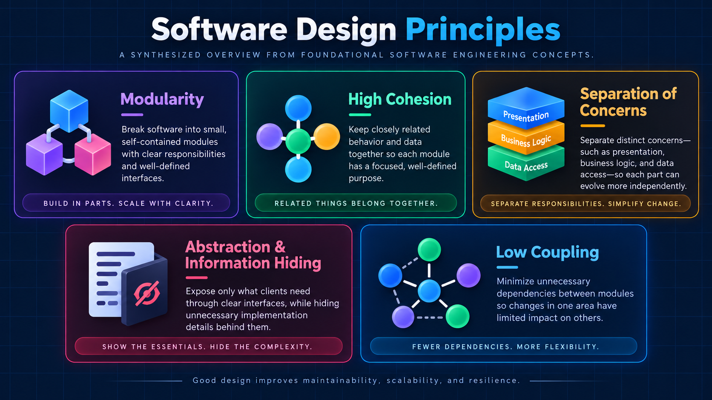

# Softwaredesign-Prinzipien: Hintergrund

Diese Datei ist die ausführliche Hintergrundreferenz zu den Softwaredesign-Prinzipien. Sie erklärt Herkunft, Bedeutung und Grenzen. Die verbindlichen, kurzen Regeln stehen in [S00 – SWE-Basis und Auswahl](design-baseline.md). Lade diese Datei nur bei Auslegungs- oder Erklärungsbedarf, nicht bei jeder Aufgabe vollständig. Bei Widerspruch gilt S00; bestehende Projektarchitektur hat Vorrang, wenn sie ausdrücklich etwas anderes vorgibt.

## Einordnung

Die Prinzipien beschreiben Eigenschaften, die Code, Tools, Pakete, Einrichtungs- und Installationsabläufe sowie Automation möglichst haben sollen: klar abgegrenzte Teile, wenig unnötiges Wissen über andere Teile und Änderungen, die nur wenige Stellen betreffen. Sie sind Sollzustände. Sie verlangen weder bestimmte Dateigrößen noch Klassen, Interfaces oder ein Architekturmuster.

## Das Bild

Das Bild ist eine Zusammenfassung, keine Voraussetzung. Der übrige Text erklärt alle fünf Prinzipien vollständig. Die Übersicht nennt sie in dieser Reihenfolge:

- Modularity: kleine, in sich geschlossene Module mit klarer Verantwortung und klar definierten Schnittstellen („Build in parts. Scale with clarity.“).
- High Cohesion: eng zusammengehörendes Verhalten und Daten liegen gemeinsam („Related things belong together.“).
- Separation of Concerns: Präsentation, Geschäftslogik und Datenzugriff sind getrennt („Separate responsibilities. Simplify change.“).
- Abstraction and Information Hiding: nach außen nur das Nötige, Details bleiben verborgen („Show the essentials. Hide the complexity.“).
- Low Coupling: wenige unnötige Abhängigkeiten zwischen Modulen („Fewer dependencies. More flexibility.“).

Die Fußzeile des Bildes lautet: „Good design improves maintainability, scalability, and resilience.“ Das ist eine allgemeine Zielaussage der Übersicht. Sie ist kein belegter Nachweis, dass diese Prinzipien Skalierung oder Ausfallsicherheit eines konkreten Systems verbessern.

## Auslegung der fünf Prinzipien

### 1. Modularität

Ein Modul ist ein abgegrenzter Teil des Systems, zum Beispiel eine Datei oder eine Gruppe zusammengehöriger Funktionen mit einer Aufgabe. Die Schnittstelle ist der Teil, den andere Teile benutzen dürfen. Ein gutes Modul hat einen klaren Zweck, eine kleine Schnittstelle und lässt sich ändern oder ersetzen, ohne andere Bereiche anzufassen. Viele kleine Dateien sind dafür nicht automatisch besser; entscheidend ist eine sinnvolle Grenze.

### 2. Hohe Kohäsion

Kohäsion beschreibt, wie gut die Teile eines Moduls zusammengehören. Hohe Kohäsion heißt: Was aus demselben Grund geändert wird, liegt zusammen. Ein Modul sollte nur einen Grund haben, geändert zu werden. Wächst eine Datei aus unabhängigen Aufgaben, ist eine Aufteilung zu prüfen. Sammelmodule wie „utils“ sind ein Warnsignal, wenn sie unverbundene Funktionen sammeln.

### 3. Trennung der Verantwortlichkeiten

Verschiedene Arten von Arbeit bleiben getrennt, zum Beispiel fachliche Regeln, Oberfläche, Datenzugriff, Netzwerk, Konfiguration, Prüfung von Eingaben und Infrastruktur. Fachregeln sollten möglichst nicht direkt an ein UI-Framework, eine bestimmte Datenbank oder einen HTTP-Client gebunden sein, wenn das vermeidbar ist.

### 4. Abstraktion und Information Hiding

Information Hiding heißt: Ein Modul verbirgt seine inneren Entscheidungen, etwa Datenstrukturen, Datenbankschema, Details einer Fremdbibliothek oder internen Zustand. Andere Teile hängen nur vom öffentlichen Vertrag ab. So kann sich die innere Umsetzung ändern, ohne dass Verbraucher angepasst werden müssen. Abstraktion heißt, nur die für Verbraucher relevanten Begriffe nach außen zu zeigen. Eine Abstraktion ohne konkreten Nutzen ist keine Verbesserung.

### 5. Geringe, bewusste Kopplung

Kopplung ist das Wissen, das ein Teil über andere braucht. Unnötige Kopplung macht Änderungen teuer. Vor einer neuen Abhängigkeit gelten die Prüffragen aus der Nutzerfassung (Abschnitt Prüfung unten). Zyklische Abhängigkeiten, bei denen A von B und B von A abhängt, sind zu vermeiden. Dependency Injection (Abhängigkeiten von außen übergeben), Adapter oder Ereignisse können helfen; sie sind Mittel, kein Selbstzweck.

## Austauschbarkeit bei stabilen Verträgen

Austauschbarkeit ist ein besonders betontes Ziel: Ein Modul darf seine innere Umsetzung ändern oder austauschen, solange sein öffentlicher Vertrag stabil bleibt und unabhängige Verbraucher unverändert funktionieren.

Ein Vertrag umfasst

- die Eingaben und ihre zulässigen Werte,
- das Ergebnis,
- die erwarteten Fehler,
- die Nebenwirkungen, etwa geschriebene Dateien, Netzwerkzugriffe oder gestartete Prozesse,
- benannte, bedeutsame Konstanten wie Zeitlimits, Grenzwerte oder Formatkennungen statt verstreuter Zahlen im Code.

Beispiel: Ein Modul liefert `load_settings()` mit dem Ergebnis `Settings` und dem Fehler `ConfigError`. Wechselt die Quelle von einer Datei zu Umgebungsvariablen, bleibt der Aufrufer unverändert, solange Ergebnis, Fehler und Nebenwirkungen gleich bleiben.

Gemeint ist die Stabilität des Vertrags. Nicht gemeint sind eine Pflicht zu Interfaces oder Klassen, eine zweite produktive Implementierung pro Modul oder mehr Dateien um ihrer selbst willen.

## Geltungsbereich und Ausnahmen

Die Prinzipien gelten übergreifend: für Code, Tools, Pakete, Installations-, Update- und Entfernungsabläufe sowie Automation. Bestehende Projektarchitektur hat Vorrang, wenn sie ausdrücklich etwas anderes vorgibt. Begründete Ausnahmen sind zulässig, etwa fachlich notwendige Kopplung, öffentliche Datenverträge oder legitime Adapter.

## Refactoring-Grenzen

Die Nutzerfassung hält fest, dass schlechte Grenzen bei einer Änderung nicht automatisch beibehalten werden sollen. Ein kleines, gezieltes Refactoring ist aber nur zulässig, wenn es im bestätigten Scope liegt und durch Tests oder ein vergleichbares Safety Net abgesichert ist. Das Beispiel im Originaltext erteilt keine zusätzliche Freigabe für Umbauten außerhalb der Aufgabe. Umfangreiche Umbauten gehören in einen eigenen, bestätigten Auftrag, siehe [core-refactor](../../core-refactor/SKILL.md).

## Prüfung vor Abschluss

Die Fragen der Nutzerfassung dienen als Abschlussprüfung, nicht als Automat. Eine Antwort mit „Nein“ führt zu einer gezielten Nachprüfung, nicht automatisch zu einer Änderung. Beantworte die Fragen für die tatsächlich geänderten Module und lasse nicht betroffene Bereiche aus.

## Grenzen des Nachweises

- Statische Textprüfungen zeigen, ob Regeln und Verweise vorhanden und gültig sind. Sie zeigen nicht, wie sich ein Agent in einer echten Aufgabe verhält.
- Tests mit kontrollierten Beispielen und Layouts belegen die geprüften Fälle, nicht die Befolgung durch ein Sprachmodell.
- Die Fußzeile des Bildes ist eine Zielaussage, kein Nachweis.
- Metriken und Benchmarkzahlen sind keine Qualitätsgarantie.

## Quellen

Die folgenden CS50-Materialien sind nur verlinkt; Passagen oder PDFs werden hier nicht kopiert.

- [CS50: Principles of Good Design (PDF)](https://cs50.harvard.edu/ap/2020/assets/pdfs/principles_of_good_design.pdf): allgemeine Gestaltungsgrundsätze.
- [CS50 AP 2026: Developing Computational Artifacts](https://cs50.harvard.edu/ap/2026/curriculum/modules/impact_of_computing/notes/#developing-computational-artifacts): Begleitnotizen zum Entwickeln rechnergestützter Artefakte.
- [CS50 AP 2021: Model-View-Controller (PDF)](https://cs50.harvard.edu/ap/2021/curriculum/x/references/mvc.pdf): ein Muster zur Trennung von Daten, Darstellung und Steuerung. Es ist eine Option, keine Pflicht.
- [CS50x: Notizen zu Woche 6](https://cs50.harvard.edu/x/notes/6/): Begleitnotizen des Kurses.

## Anhang: ursprüngliche Nutzerfassung

Die folgende Fassung ist unverändert übernommen. Sie ist Erläuterung, keine zusätzliche Freigabe über die bestätigten Scopes und Workflowverträge hinaus.

# Anweisungen zum Schreiben von Code

## Prinzipien der Softwarearchitektur

Beim Erstellen, Ändern oder Refaktorieren von Code ist auf eine wartbare Softwarearchitektur zu achten. Die folgenden Prinzipien sind einzuhalten, sofern die bestehende Projektarchitektur nicht ausdrücklich etwas anderes vorgibt.

### 1. Code modular halten

Das System soll als Sammlung kleiner, klar abgegrenzter Module strukturiert sein.

Jedes Modul sollte:

- einen klaren Zweck haben,
- eine möglichst kleine öffentliche Schnittstelle bereitstellen,
- austauschbar oder erweiterbar sein, ohne unnötige Änderungen an anderen Bereichen zu verursachen,
- möglichst wenig Wissen über andere Module besitzen.

Bevorzuge mehrere fokussierte Komponenten gegenüber großen Dateien oder Klassen, die unterschiedliche Verantwortlichkeiten übernehmen.

Führe keine neuen Abstraktionen nur um der Abstraktion willen ein. Erstelle Module dort, wo sie eine sinnvolle architektonische Grenze darstellen.

---

### 2. Hohe Kohäsion sicherstellen

Eng zusammengehörige Funktionalität soll gemeinsam organisiert werden.

Code, der zur gleichen Verantwortung, zum gleichen fachlichen Konzept oder zum gleichen Feature gehört, sollte nach Möglichkeit zusammenliegen.

Ein Modul sollte möglichst nur einen klaren Grund haben, geändert zu werden.

Wenn eine Datei, Klasse, ein Service oder eine Funktion beginnt, mehrere voneinander unabhängige Verantwortlichkeiten zu übernehmen, sollte geprüft werden, ob eine Aufteilung in kleinere, stärker fokussierte Komponenten sinnvoll ist.

Vermeide allgemeine `Utils`- oder Hilfsmodule, die im Laufe der Zeit zu Sammlungen nicht zusammengehöriger Funktionen werden.

---

### 3. Verantwortlichkeiten klar trennen

Unterschiedliche Arten von Verantwortlichkeiten sollen voneinander getrennt werden.

Beispiele:

- Geschäfts- und Domänenlogik,
- Präsentations- und UI-Logik,
- Datenzugriff,
- API- und Netzwerkkommunikation,
- Persistenz,
- Konfiguration,
- Authentifizierung und Autorisierung,
- Validierung,
- Infrastruktur.

Geschäftslogik sollte nicht direkt von UI-Frameworks, konkreten Datenbankimplementierungen, HTTP-Clients oder anderen Infrastrukturdetails abhängig sein, sofern dies vermeidbar ist.

Bevorzuge klare architektonische Grenzen, damit sich einzelne Bereiche unabhängig voneinander weiterentwickeln können.

---

### 4. Abstraktion und Information Hiding verwenden

Nach außen soll nur das sichtbar sein, was andere Teile des Systems tatsächlich benötigen.

Implementierungsdetails sollen innerhalb des verantwortlichen Moduls verborgen bleiben.

Andere Komponenten sollten möglichst von stabilen Schnittstellen oder Verträgen abhängen und nicht von internen Implementierungsdetails.

Vermeide es, folgende Details unnötig über Modulgrenzen hinweg offenzulegen:

- interne Datenstrukturen,
- Datenbankschemata,
- Details von Drittanbieter-Bibliotheken,
- internen Zustand,
- implementationsspezifisches Verhalten.

Ausnahmen gelten nur dann, wenn diese Details bewusst Teil des öffentlichen Vertrags sind.

Wenn sich interne Implementierungsdetails ändern, sollten davon unabhängige Verbraucher möglichst nicht betroffen sein.

---

### 5. Kopplung bewusst verwalten

Unnötige Abhängigkeiten zwischen Komponenten sollen vermieden werden.

Bevorzuge:

- geringe Kopplung zwischen Modulen,
- hohe Kohäsion innerhalb eines Moduls.

Abhängigkeiten sollten sich möglichst auf stabile Abstraktionen statt auf volatile Implementierungsdetails beziehen.

Bevor eine neue Abhängigkeit eingeführt wird, ist zu prüfen:

1. Ist diese Abhängigkeit tatsächlich notwendig?
2. Existiert bereits eine passende Abstraktion?
3. Entsteht dadurch eine zyklische Abhängigkeit?
4. Wird der Code dadurch schwieriger zu testen?
5. Werden dadurch unnötig Implementierungsdetails offengelegt?

Zyklische Abhängigkeiten sind zu vermeiden.

Wo sinnvoll, sollen Dependency Injection, Interfaces, Events, Adapter oder vergleichbare Muster verwendet werden, um Komponenten voneinander unabhängig zu halten.

---

## Regel für Architekturentscheidungen

Wenn mehrere Implementierungen möglich sind, bevorzuge die Lösung, die:

1. Verantwortlichkeiten klar hält,
2. Kopplung minimiert,
3. Kohäsion maximiert,
4. Implementierungsdetails verbirgt,
5. Modulgrenzen erhält,
6. einfach verständlich und testbar bleibt.

Erhöhe die architektonische Komplexität nicht ohne konkreten Nutzen.

Einfache und explizite Architektur ist cleveren, aber schwer verständlichen Lösungen vorzuziehen.

---

## Erwartungen beim Refactoring

Beim Ändern bestehenden Codes sollen schlechte Architekturgrenzen nicht automatisch beibehalten werden.

Wenn eine angeforderte Änderung Probleme sichtbar macht wie:

- doppelte Verantwortlichkeiten,
- übermäßige Kopplung,
- vermischte Zuständigkeiten,
- nach außen dringende Implementierungsdetails,
- übergroße Module,
- zyklische Abhängigkeiten,

soll ein kleines und gezieltes Refactoring durchgeführt werden, sofern es die Implementierung klar verbessert und im Rahmen der eigentlichen Aufgabe bleibt.

Unnötige oder umfangreiche Refactorings außerhalb des Aufgabenbereichs sind zu vermeiden.

---

## Prüfung vor Abschluss einer Aufgabe

Bevor eine Coding-Aufgabe als abgeschlossen betrachtet wird, ist zu prüfen:

- Hat jedes geänderte Modul eine klare Verantwortung?
- Liegt zusammengehöriges Verhalten an einer gemeinsamen Stelle?
- Sind voneinander unabhängige Verantwortlichkeiten getrennt?
- Sind Implementierungsdetails ausreichend verborgen?
- Wurden unnötige Abhängigkeiten eingeführt?
- Sind die Modulgrenzen weiterhin klar?
- Kann der geänderte Code getestet werden, ohne unnötig andere Teile des Systems einzubeziehen?
- Ist die Architektur einfacher oder zumindest nicht komplizierter geworden?

Wenn eine dieser Fragen mit „Nein“ beantwortet wird, sollte die Implementierung vor Abschluss der Aufgabe noch einmal überprüft werden.
